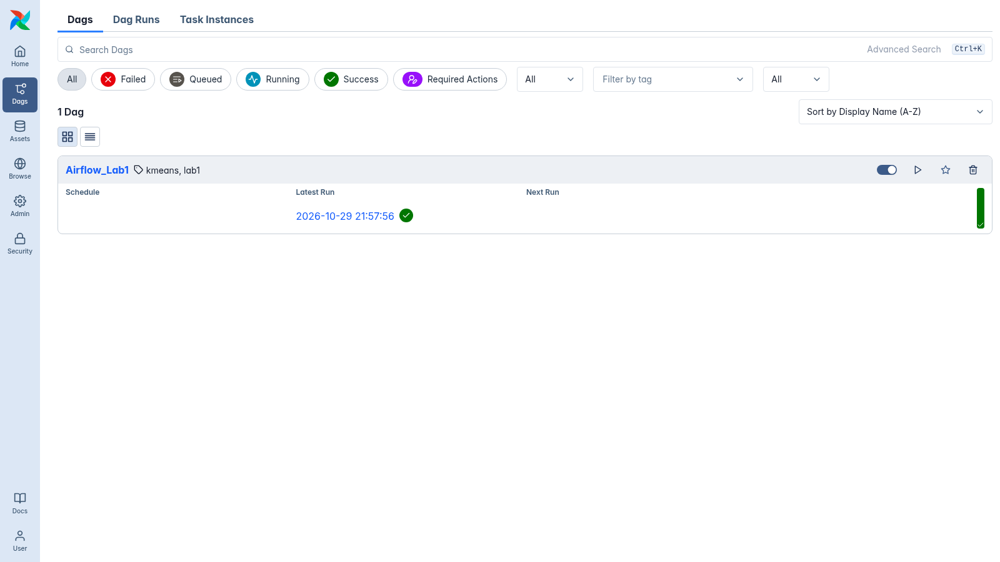
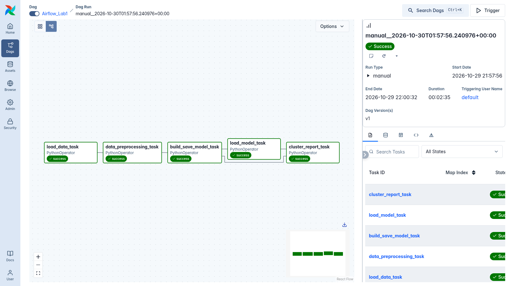
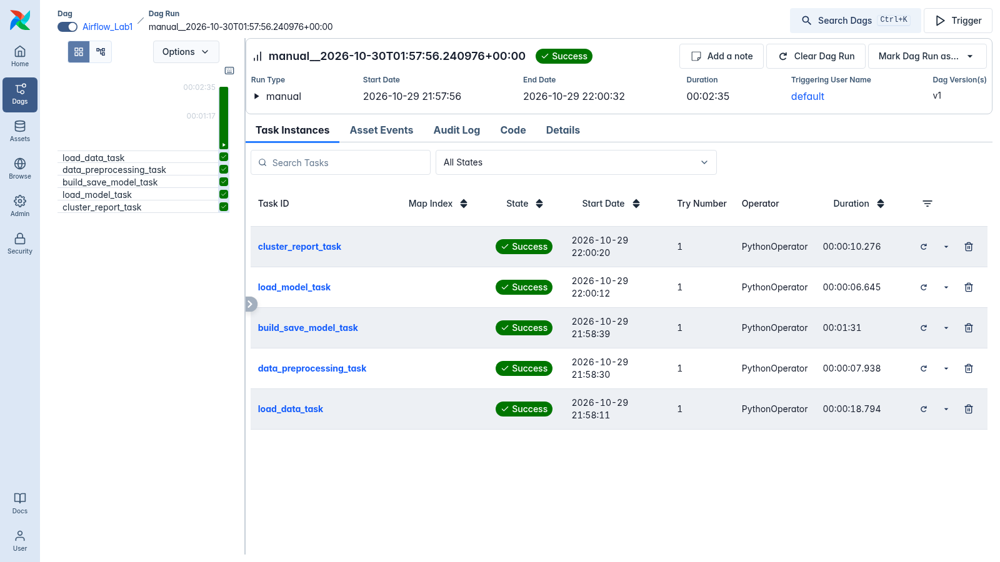
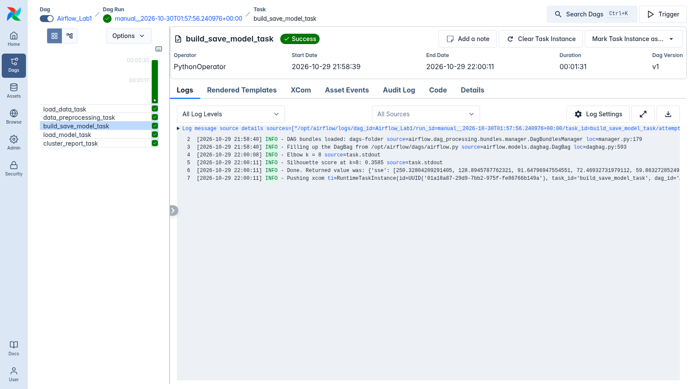
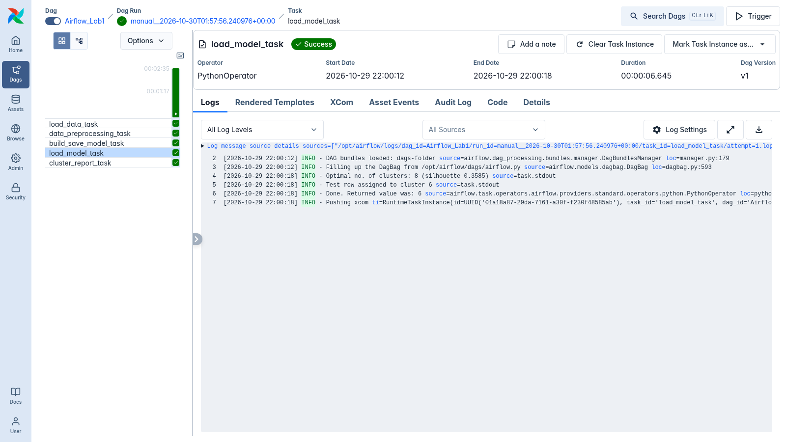
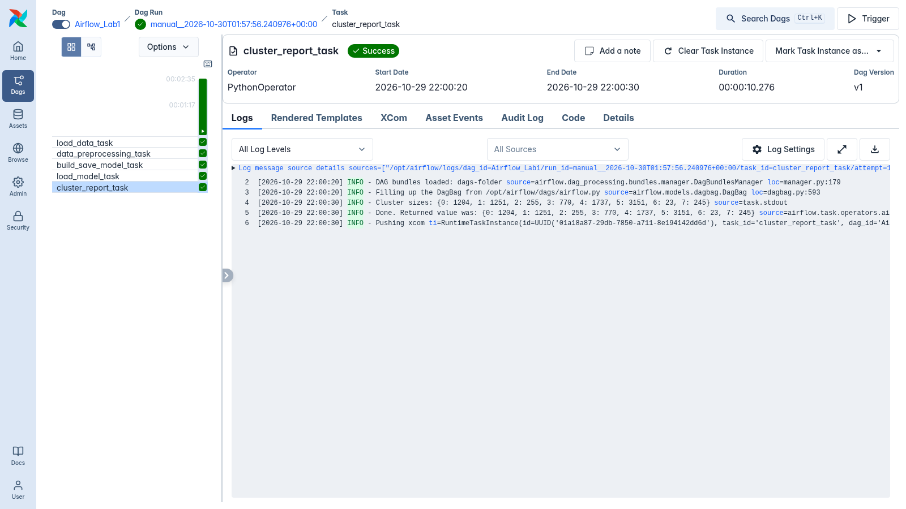

# Airflow Lab 1: KMeans clustering pipeline

An Airflow 3.1 DAG (`Airflow_Lab1`) that clusters credit-card customers with KMeans, picks `k` with the elbow method, and profiles the resulting clusters.

- Video: [Airflow Lab1 Tutorial](https://youtu.be/exFSeGUbn4Q?feature=shared)
- Blog: [AirFlow Lab-1](https://www.mlwithramin.com/blog/airflow-lab1)
- Airflow docs: https://airflow.apache.org/docs/

## Pipeline

```
load_data_task >> data_preprocessing_task >> build_save_model_task >> load_model_task >> cluster_report_task
```

| Task | Function (`dags/src/lab.py`) | What it does |
|------|------------------------------|--------------|
| `load_data_task` | `load_data()` | Reads `data/file.csv`, returns it base64-pickled (JSON-safe XCom). |
| `data_preprocessing_task` | `data_preprocessing(data)` | Drops NaNs, min-max scales `BALANCE`, `PURCHASES`, `CREDIT_LIMIT`, saves the fitted scaler to `model/scaler.sav`. |
| `build_save_model_task` | `build_save_model(data, filename)` | Fits KMeans for k=1..49, picks k with `KneeLocator`, refits at that k, computes the silhouette score, saves `model/model.sav`. Returns `{sse, best_k, silhouette}`. |
| `load_model_task` | `load_model_elbow(filename, summary)` | Loads model + scaler, scales `data/test.csv` with the training scaler, returns the predicted cluster. |
| `cluster_report_task` | `save_cluster_report(filename, summary)` | Labels the full dataset, writes `model/cluster_report.json` (sizes + centroids in original units), returns cluster sizes. |

## Changes from the original lab

**`dags/src/lab.py`**
- Test data is now scaled with the scaler fitted on training data. The original predicted on raw `test.csv` against a model trained on scaled data.
- The saved model is the elbow-`k` model. The original saved the last model of the loop (k=49).
- Silhouette score is computed and logged for the chosen `k`.
- `build_save_model` returns a dict (`sse`, `best_k`, `silhouette`) instead of the SSE list; `load_model_elbow` takes that dict.
- New `save_cluster_report()` for the 5th task.
- Removed the debug print; added row-count and prediction logs.

**`dags/airflow.py`**
- Added `cluster_report_task` and extended the dependency chain.
- Added `schedule=None` and `tags=['lab1', 'kmeans']`; updated the description.

**Setup**
- `config/airflow.cfg`: `load_examples = False`.
- `docker-compose.yaml` (official Airflow 3.1.5, gitignored in this repo): examples off, `pandas scikit-learn kneed` installed at container start via `_PIP_ADDITIONAL_REQUIREMENTS`.

## Results

On this dataset (8,950 rows, 18 columns; rows with NaNs are dropped before scaling):

- Elbow `k = 8`, silhouette `0.3585`.
- The first row of `test.csv` is assigned to cluster `6`.
- Cluster sizes: `{0: 1204, 1: 1251, 2: 255, 3: 770, 4: 1737, 5: 3151, 6: 23, 7: 245}`.
- Full report: [`assets/cluster_report.json`](assets/cluster_report.json).

## Run it

Prerequisites: Docker with at least 4 GB (ideally 8 GB) of memory.

```bash
# 1. get the compose file (not tracked in git)
curl -LfO https://airflow.apache.org/docs/apache-airflow/3.1.5/docker-compose.yaml
# then set AIRFLOW__CORE__LOAD_EXAMPLES to 'false' and
# _PIP_ADDITIONAL_REQUIREMENTS default to 'pandas scikit-learn kneed'

# 2. prepare folders and UID
mkdir -p ./logs ./plugins
echo "AIRFLOW_UID=$(id -u)" > .env

# 3. init and start
docker compose up airflow-init
docker compose up -d
```

Open http://localhost:8080 and sign in with `airflow` / `airflow` (the compose default). Unpause `Airflow_Lab1` and trigger it. Or from the CLI:

```bash
docker compose exec airflow-scheduler airflow dags unpause Airflow_Lab1
docker compose exec airflow-scheduler airflow dags trigger Airflow_Lab1
```

Stop with `docker compose down` (add `-v` to also drop the database volume).

`setup.sh` resets the environment (removes `.env`, `logs`, `plugins`, `config`, and volumes) and prints the Airflow config. Note it deletes `./config`, so restore `config/airflow.cfg` afterwards if you want the custom one.

## Deployed on GCP

The lab was run end to end on a throwaway Google Compute Engine VM (`e2-standard-2`, Ubuntu 22.04, Docker + the compose stack above). The UI was reached over an SSH tunnel (`-L 18080:localhost:8080`), so no port was opened publicly. The VM and its disk were deleted afterwards.

| Screenshot | Shows |
|-----------|-------|
|  | `Airflow_Lab1` registered in the UI |
|  | All 5 tasks in graph view, all successful |
|  | Run summary, task instances all `success` |
|  | Elbow k and silhouette logged by `build_save_model_task` |
|  | `load_model_task`: optimal k and predicted cluster |
|  | `cluster_report_task`: cluster sizes |

## Files

```
dags/airflow.py        DAG definition
dags/src/lab.py        task functions
dags/data/file.csv     training data
dags/data/test.csv     one row to predict
config/airflow.cfg     Airflow config mounted into the containers
assets/                screenshots and cluster_report.json from the GCP run
```
