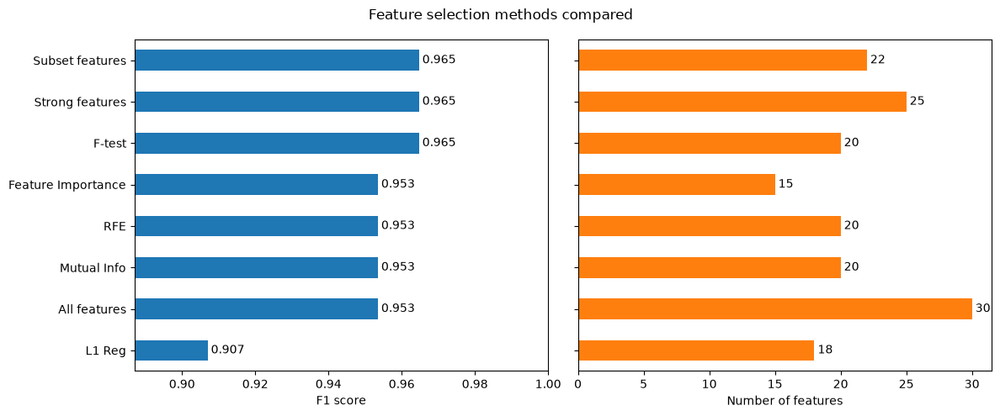
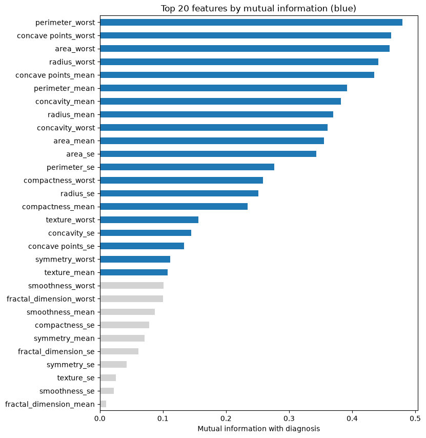

# Feature Selection Lab

Compares feature selection techniques on the Wisconsin breast cancer dataset (`data/breast_cancer_data.csv`).
A Random Forest is trained on each selected feature set and scored on the same stratified test split.

- **Filter methods:** correlation with the target, removing features that are correlated with each other, F-test (`SelectKBest`), mutual information
- **Wrapper method:** Recursive Feature Elimination (RFE)
- **Embedded methods:** Random Forest feature importances, L1 regularization (`LinearSVC`)

## Changes from the original lab
- Runs on current pandas (3.x): `Series.iteritems()` replaced with `.index`, `DataFrame.append()` with `pd.concat`, positional `drop(..., 1)` with `drop(columns=...)`, and `inplace=True` drops with reassignment
- Correlation filters computed on the training rows only, so the test set no longer influences which features are picked (it selects the same 25 features, so the results did not change)
- ROC AUC computed from predicted probabilities instead of hard 0/1 predictions
- Feature importance model is seeded (`random_state=47`) so the selected features are the same on every run
- Removed duplicate `SelectFromModel` import and used `X.columns` instead of repeating `df.drop("diagnosis_int", ...)`
- **New:** mutual information filter (`SelectKBest` + `mutual_info_classif`) with a bar chart of every feature's score
- **New:** summary chart comparing F1 score and feature count for every method
- Added `requirements.txt` and saved the notebook with its outputs

## Results
| Method | Accuracy | ROC AUC | F1 | Features |
|---|---|---|---|---|
| All features | 0.965 | 0.980 | 0.953 | 30 |
| Strong features | 0.974 | 0.988 | 0.965 | 25 |
| Subset features | 0.974 | 0.991 | 0.965 | 22 |
| F-test | 0.974 | 0.987 | 0.965 | 20 |
| Mutual Info | 0.965 | 0.988 | 0.953 | 20 |
| RFE | 0.965 | 0.988 | 0.953 | 20 |
| Feature Importance | 0.965 | 0.982 | 0.953 | 15 |
| L1 Reg | 0.930 | 0.989 | 0.907 | 18 |

The F-test reaches the best F1 score with the fewest features (20). Feature Importance cuts the set to 15 features and scores the same as using all 30.





## Usage
```bash
python -m venv .venv
source .venv/bin/activate
pip install -r requirements.txt
jupyter notebook Feature_Selection.ipynb
```
